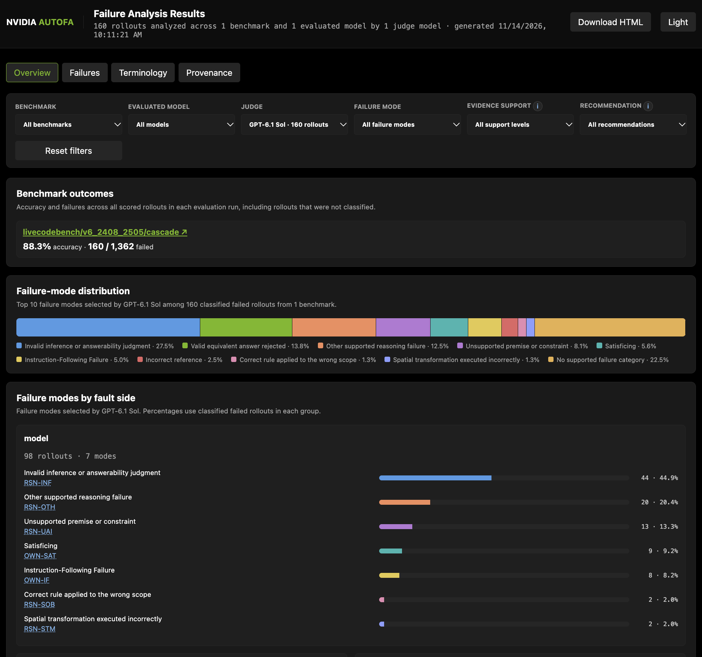
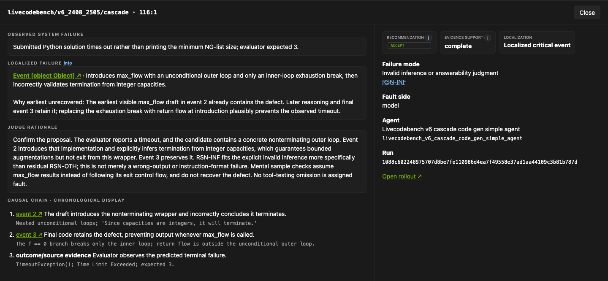

# Tutorial: explore and run AutoFA on bundled rollouts

These archives contain example rollouts, so you can test AutoFA without running
evaluations yourself. Each config reproduces the updated setup: up to 1,362
failed rollouts, two Codex agentic taxonomy passes, and four workers. Run all
commands from the repository root.

## Example reports

Download any self-contained report and open the HTML file locally:

- [Download the `thinkingmachines/Inkling-Small` report](https://github.com/NVIDIA/AutoFA/raw/refs/heads/main/eval_data/example_reports/inkling.html)
- [Download the `zai-org/GLM-5.3-Flash` report](https://github.com/NVIDIA/AutoFA/raw/refs/heads/main/eval_data/example_reports/glm.html)
- [Download the `nvidia/NVIDIA-Nemotron-3.5-Super-VL-120B-A12B-BF16` report](https://github.com/NVIDIA/AutoFA/raw/refs/heads/main/eval_data/example_reports/super.html)

### What the report looks like



The `thinkingmachines/Inkling-Small` overview summarizes benchmark outcomes and shows how
diagnosed failures are distributed across the taxonomy.



The `nvidia/NVIDIA-Nemotron-3.5-Super-VL-120B-A12B-BF16` failure detail shows the localized
critical event, supporting evidence, judge rationale, causal chain and recommended disposition.

### Interpreting the reports

These are diagnostic views of failed rollouts, not model rankings or overall
benchmark accuracy. They group failures by likely fault side, making it possible
to find problems in the benchmark as well as in the evaluated models.

For example, `Valid equivalent answer rejected` appears in 17 `zai-org/GLM-5.3-Flash`
rollouts and 22 `thinkingmachines/Inkling-Small` rollouts. Seeing the same diagnosis across
models points to a benchmark-grader problem: a valid answer can receive zero reward. AutoFA
surfaced this automatically instead of assuming that every failed score was caused by the model.

The model-side profiles are different. `zai-org/GLM-5.3-Flash` is dominated by state-tracking
failures (99 of 264 analyzed failures), while `thinkingmachines/Inkling-Small` more often makes
invalid inference or answerability judgments (44 of 160) and also shows some satisficing
(9 of 160). Finally, `No supported failure category` remains substantial for both
`zai-org/GLM-5.3-Flash` (104 of 264) and `thinkingmachines/Inkling-Small` (36 of 160). Those
unexplained cases show where AutoFA's methods can improve to cover more unknown failure modes.

## 1. Set up

```sh
brew install zstd
uv sync --python 3.12 --inexact
codex login status
```

Run `codex login` if needed.

## 2. Extract the example rollouts

```sh
mkdir -p eval_data/uncompressed
zstd -dc eval_data/inkling.tar.zst | tar -xf - -C eval_data/uncompressed
zstd -dc eval_data/glm.tar.zst | tar -xf - -C eval_data/uncompressed
zstd -dc eval_data/super.tar.zst | tar -xf - -C eval_data/uncompressed
```

## 3. Run AutoFA

These commands can make thousands of Codex model calls:

```sh
export AUTOFA_HOME="$PWD/.tmp/autofa-eval-data"
uv run --no-sync autofa run --config eval_data/inkling.yaml --once
uv run --no-sync autofa run --config eval_data/glm.yaml --once
uv run --no-sync autofa run --config eval_data/super.yaml --once
```

Reports are written to:

- `eval_data/outputs/inkling/report.html`
- `eval_data/outputs/glm/report.html`
- `eval_data/outputs/super/report.html`
